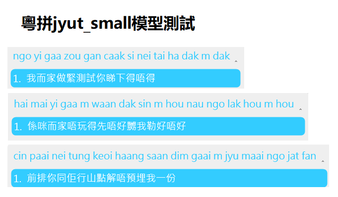

# 粵語小詞庫 Jyut_small語言模型


給 Windows 小狼毫（Weasel）用的**粵語全拼輸入方案**。用粵拼（Jyutping）打字，配合一個
4-gram 粵語語言模型，讓長句的首選更接近自然說法。

方案本身以 Rime 的 `script_translator` 運作，詞庫約 7.2 萬條，模型約 70 MB。
不依賴任何第三方外掛，不安裝背景服務，不改動其他輸入法方案。

- 另外還提供一個擁有適用模型、輔助碼篩選模式的[雙拼方案](https://github.com/yuOpghH/rime-jyutsp-real-model)
  
---

- 目前版本：1.2（2026-11-20）
- 適用：Windows 10／11，小狼毫 Weasel 0.15 以上
- 授權：方案與文件 CC BY-SA 4.0；含粵典衍生內容的部分依 NCODL 1.0（僅限非商業）

---
聲明：本包主要通過AI許願式編程而成，AI+人工多次校驗、多音字與詞庫權重經由人工調整、readme由AI+人工潤色。<b>以防萬一，執行前請預先進行好備份</b>

<p align="center">

</p>

---

## 支援哪種編碼

| 項目 | 說明 |
|---|---|
| 輸入碼 | **粵拼（Jyutping）**，帶聲調，格式 `jyut6ping3`（例 `ngo5 dei6`） |
| 實際鍵入 | 可只打字母（無調），也可打聲調數字；亦可只打首字母簡拼 |
| 候選顯示 | 漢字候選，附粵拼提示 |
| 繁體／簡體 | 內建四個方案：繁體（香港字形）兩個、簡體兩個；簡體由 OpenCC `t2s.json` 轉換輸出 |
| 標點 | `/` 開頭查符號；預設粵語標點配置 |

方案內建 `algebra` 會把聲調數字轉成字母再分音節，因此**無調連打**是主要用法，
例如「我哋今日」可打 `ngo dei gam jat`，也可以打 `ngodeigamjat`（自動分音節），
或只打首字母 `n d g j`。

## 四個方案怎麼選

安裝包內有四個方案，**詞庫完全相同**，只差「用字（繁／簡）」與「語言模型（詞級／字級）」：

| 方案 | 顯示名 | 模型 | 預設用字 |
|---|---|---|---|
| `jyut_small` | 粵語小詞庫（詞級模型） | `jyut.gram` | 繁體（香港字形） |
| `jyut_small_char` | 粵語小詞庫（字級模型） | `jyut_char.gram` | 繁體（香港字形） |
| `jyut_small_simp` | 粵語小詞庫（詞級模型）(簡體) | `jyut.gram` | 簡體 |
| `jyut_small_char_simp` | 粵語小詞庫（字級模型）(簡體) | `jyut_char.gram` | 簡體 |

簡體方案只是預設開啟 `zh_simp`／`simplification` 選項，詞庫索引仍是繁體；
四個方案共用同兩份詞庫與同兩份模型，部署後 `build\` 只會建立 `jyut_small.*` 與
`jyut_small_char.*` 兩套二進位，不會因方案數變多而增加部署時間。

以下為兩個繁體方案的 60 句實測（冷啟動，整句一次上屏）：

| 指標 | 詞級模型 | 字級模型 |
|---|---|---|
| 整句完全正確 | 70.0% | 75.0% |
| 單字錯誤率 | 12.5% | 12.0% |
| 正確答案在前三 | 73.3% | 78.3% |
| 正確答案平均名次 | 3.48 | 2.98 |

差距約 5 個百分點，屬邊緣級別。建議兩個都裝，用自己最常打的句子各試一輪再決定。
若只想裝一個：**常打長句選字級，常打短詞選詞級**。

## 安裝

### 你需要什麼

1. Windows 10／11。
2. 已安裝小狼毫並執行過一次（讓它建立用戶資料夾）。
3. 下載 `jyut_small_fullspell_20261108.zip`，解壓到一個**不會馬上刪除**的資料夾
   （腳本的備份會放在解壓後的 `backup\`）。

### 三步安裝

在解壓後的資料夾按 Shift + 右鍵 →「在此處開啟 PowerShell」，然後：

```powershell
# 第一步：預演，看它會做什麼（不寫入任何檔案）
.\install.ps1 -DryRun

# 第二步：正式安裝（會先備份）
.\install.ps1
```

第三步：**重新部署**。右鍵點工作列輸入法圖示 →「重新部署」。
首次部署要建立詞庫快取，約數十秒到兩分鐘，屬正常現象。

安裝完成後，右鍵輸入法圖示 →「輸入法方案」→ 選「粵語小詞庫（詞級模型）」
「粵語小詞庫（字級模型）」，或對應的簡體版本（顯示名後帶「(簡體)」）。

### 如果用戶資料夾不在預設位置

```powershell
.\install.ps1 -RimeDir "<Rime 使用者目錄>"
```

腳本會依序尋找 `<Rime 使用者目錄>`、`%APPDATA%\Rime`，都找不到就停下來報錯，
不會亂寫檔案。

### 手動安裝

不想用腳本也可以：把 `schema\` 內的 16 個 yaml 與 `model\` 內兩個 `.gram`
複製到 Rime 用戶資料夾（同一層），再把下面四行加進 `default.custom.yaml` 的 `schema_list`：

```yaml
- {schema: jyut_small}
- {schema: jyut_small_char}
- {schema: jyut_small_simp}
- {schema: jyut_small_char_simp}
```

然後重新部署。

## 卸載與回退

```powershell
.\uninstall.ps1 -List          # 看有哪些備份
.\uninstall.ps1 -DryRun        # 預演
.\uninstall.ps1                # 還原最近一次安裝前的狀態
.\uninstall.ps1 -RemoveScheme  # 還原，並移除本方案新增的檔案與 schema_list 條目
```

還原後要再按一次「重新部署」。如果你當初是手動安裝、沒有備份，
可刪除 `jyut_small*` 的 yaml、兩個 `.gram`，再從 `schema_list` 刪掉那四行。

## 模型是什麼

模型是一個「哪個字接哪個字比較常見」的統計表，不是神經網絡，也不上網。

- 演算法：4-gram（看前 3 個單位預測下一個單位）
- 訓練工具：KenLM `lmplz -o 4 --prune 0 1 1 1`
- 格式：`Rime::Grammar/1.0` ＋ Darts 雙陣列，由 Rime 內建 librime-octagram 直接載入
- 詞級模型以「詞」為單位，字級模型以「單字」為單位；兩者用同一批語料訓練
- 大小：詞級 77,299,756 bytes；字級 72,767,532 bytes
- 部署後常駐記憶體約 200–300 MB（兩個模型只會載入正在使用的那一個）

模型只影響**候選排序**，不影響你能不能打出字。刪掉模型後方案仍可正常使用，
只是長句首選會退步。

## 常見問題

**Q：切換方案後沒有「粵語小詞庫」？**
A：`default.custom.yaml` 的 `schema_list` 沒寫入，或沒有重新部署。重新執行安裝腳本並部署。

**Q：打了字但候選是空的？**
A：通常是 schema 設定不完整或詞庫沒建表。確認 16 個 yaml 與兩個模型都在 Rime 用戶資料夾，
然後完整重新部署（不是只按一次圖示）。

**Q：長句首選不順？**
A：先確認模型已載入（見下一題）。若已載入，長句本來就受同音影響；試著在詞與詞之間留空格，
或改用字級模型。

**Q：怎麼知道模型有沒有載入？**
A：部署後打開 `%TEMP%\rime.weasel\` 最新的 `*.INFO` 日誌，搜 `gram_db`。
詞級應有 `use grammar: jyut` 與 `found double array image of size 19324928`；
字級應有 `use grammar: jyut_char` 與 `found double array image of size 18191872`。

**Q：以前打錯的句子一直排在第一位？**
A：那是 Rime 的學習紀錄（`*.userdb`）。它比任何詞庫權重都高。
處理方式：退出小狼毫，把 `jyut_small.userdb` 資料夾移到備份位置，重新部署。

**Q：可以打簡體嗎？**
A：可以。本包已內建兩個簡體方案（`jyut_small_simp`、`jyut_small_char_simp`），
安裝後在輸入法選單直接切換；也可以在任一方案按 `Ctrl+q` 切換「漢字／汉字」。
簡體是輸出時經 OpenCC `t2s.json` 轉換，詞庫本身仍以繁體為索引。

**Q：可以商用嗎？**
A：方案檔與文件是 CC BY-SA 4.0；但詞庫與模型含粵典（words.hk）衍生內容，
該部分依 NCODL 1.0 **僅限非商業**，且不可再授權。詳見 `LICENSE.md`。

**Q：可以在 macOS／Linux 用嗎？**
A：本包是為小狼毫打包的（Windows）。方案檔與模型本身跨平台，但安裝腳本是 PowerShell，
其他平台需手動複製檔案並重新部署。

**Q：可以自己加詞嗎？**
A：可以。在 Rime 用戶資料夾新增或修改詞庫 yaml，或使用 Rime 的使用者詞典功能，
然後重新部署。注意新詞權重不要遠高於同音既有詞，否則會壓過原本的排序。

**Q：為什麼有「詞級」和「字級」兩個模型，不能只留一個？**
A：兩者對不同句型的偏好不同。保留兩個讓你可以實測後再選，成本只是多一個模型檔。

## 已知限制

- **同音競爭**：無調輸入必然出現大量同音字（`jyu geoi` → 語句／雨具），詞庫只能緩解，不能全對。
- **口語 vs 書面**：語料以維基、新聞為主，書面長句表現較好；純口語句子仍可能被推向書面詞。
- **模型會過度糾正**：偶爾把口語常見寫法改成高頻書面搭配。
- **分詞影響很大**：連打靠演算法分音節，切錯就整句錯；長句建議詞間留空格。
- **句末語氣詞**：字級模型在句末「㗎嘛」仍可能輸出「加碼」，屬已知現狀。
- **香港粵語為主**：其他粵語區的用詞、地名可能缺漏。
- **長尾詞庫預設關閉**：另有 4.9 萬條低頻詞隨包附上，預設不掛載（會拖慢部署）。
- **不含雙拼**：本包只含全拼方案，不含任何雙拼或實驗方案。

## 這個包裡有什麼

```
jyut_small_fullspell_20261108.zip
├─ install.ps1 / uninstall.ps1
├─ README.md / LICENSE.md / TEST_CASES.md / CHANGELOG.md
├─ schema\   （4 個方案 + 11 個詞庫層 + symbols 補丁，共 16 個 yaml）
└─ model\    （jyut.gram / jyut_char.gram）
```

另有 `yue_ngram_kit_20261108.zip`，給**已有自己的粵拼方案**的人接入模型與詞庫，
內含接入說明、範例 patch 與只安裝模型的腳本。它不會改動你現有的方案。

## 授權與致謝

- 詞形與粵拼部分來自 **粵典 words.hk**（Hong Kong Lexicography Limited），
  依《非商業開放資料授權協議 1.0》使用。非商業用途可再散佈，需保留署名與告示。
- 語料來源：HKCanCor（CC BY 4.0）、raptorkwok 平行語料（CC0）、
  izhx/yue-lihkg-topic（CC BY 4.0）、中文／粵文維基（CC BY-SA）、zh-wiki-yue-long（CC BY-SA）。
- `symbols_cantonese.yaml` 由 **亶父** 提供。
- 輸入法引擎：Rime／librime／librime-octagram。

完整授權條文、英文告示與 Credits List 見包內 `LICENSE.md`。

## 回報問題

請附上：輸入碼、預期結果、實際結果、使用哪個模型，以及日誌中 `gram_db` 相關的幾行。
有具體句子比「不好用」更容易修。
